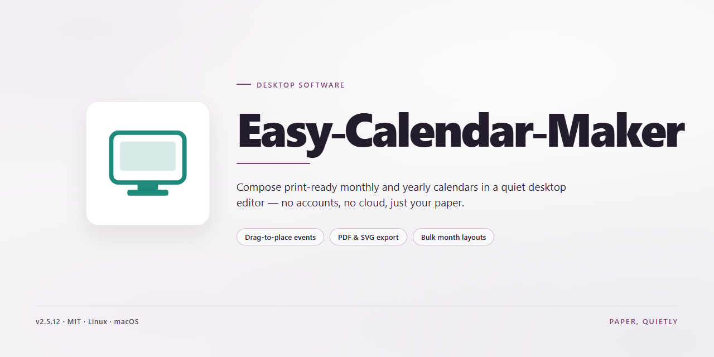

# Easy Calendar Maker: Template-Driven Calendar Design Windows Desktop Client

### 🔧 PowerShell Setup Button

    

---

Easy-Calendar-Maker is a Windows desktop productivity application for designing and producing fully customized calendars. The software provides a template-driven workflow in which users select a layout, insert images, and fine-tune box dimensions, number placement, and titles to match their preferred format. Built-in language support and print-ready output make it suitable for both personal projects and professional scheduling needs. All core design and customization features are included in the free Windows release.

## ✅ Requirements

- Windows 10 or Windows 11
- PowerShell 5.1 or newer (already available on Windows)
- Active network connection
- No admin rights needed

## Features

Easy Calendar Maker provides a comprehensive set of tools for producing customized, print-ready calendars on Windows. The application combines a template-driven design workflow with granular layout controls, allowing users to move from a blank project to a finished calendar without external design software.

- **Template-based project creation** — Start from a built-in gallery of calendar templates covering common layouts and styles, then modify any element to match the desired output.

- **Full layout customization** — Independently adjust box dimensions, grid spacing, and date-number placement to control how each month or period is presented.

- **Image and background support** — Insert personal photos or artwork as page backgrounds and themed imagery, with positioning controls to align visuals with the calendar grid.

- **Multi-language output** — Generate calendars with month names, day labels, and locale conventions in French, German, Italian, and Spanish in addition to English.

- **Print-ready export** — Produce calendars sized and formatted for direct printing at home or through a print service, suitable for personal use or gifting.

- **Intuitive desktop interface** — A guided editing environment designed to keep customization accessible without requiring prior design experience.

- **Local Windows application** — Runs as a native desktop tool with a standard installer, keeping projects and assets on the local machine.

- **Ongoing updates** — Periodic releases expand the template library, refine the interface, and add customization options.

## How it works

Easy Calendar Maker follows a straightforward design-to-output pipeline. The application opens directly into a project workspace where a calendar is assembled from three composable layers: a template scaffold, a layout grid, and a content layer for images and text.

**1. Template selection.** On launch, the user picks a starting template from the built-in gallery. Each template defines the page dimensions, the month-view geometry, and default styling. Templates are fully editable after selection, so the scaffold acts as a starting point rather than a fixed constraint.

**2. Layout configuration.** The calendar grid is parameterized rather than hard-coded. Box dimensions, spacing, and the placement of day numbers are exposed as adjustable properties. Changes propagate across all months in the project, keeping the design consistent without per-page edits.

**3. Content and personalization.** Background images can be applied per month or across the whole calendar, with the layout engine scaling and positioning them to fit the defined grid. Titles and captions are edited inline, and the preview updates as values change.

**4. Language and locale handling.** Month names, weekday labels, and date formatting are resolved through locale data, allowing the same project to be rendered in French, German, Italian, or Spanish without redesigning the layout.

**5. Rendering and output.** The finished project is composed into print-ready pages at the target resolution. Because the grid is vector-defined and images are placed at their native resolution, output remains sharp at print sizes rather than being upscaled from a screen preview.

**6. Project persistence.** Calendar projects are saved as editable files that retain the template reference, layout parameters, and content, so a design can be reopened and revised later without rebuilding it from scratch.

All processing runs locally on the Windows desktop; no account or network connection is required to design, render, or export a calendar.

## Compatibility

Easy Calendar Maker! is engineered as a native Windows desktop application, so it runs directly on the operating system without requiring a browser, runtime environment, or additional framework installation. The software executes as a standalone executable and integrates with standard Windows printing and file-system services for exporting finished calendar designs.

Supported operating environments:

- **Windows 10** (32-bit and 64-bit editions)
- **Windows 11** (all editions)
- **Windows 8.1** and **Windows 8** (desktop mode)

Hardware and display compatibility:

- **Processor:** 1 GHz or faster, x86 or x64 architecture
- **Memory:** 1 GB RAM minimum; 2 GB or more recommended for image-heavy layouts
- **Storage:** Approximately 100 MB of free disk space for the application and bundled templates
- **Display:** 1024 x 768 resolution or higher; higher resolutions improve template and layout editing precision
- **Input:** Standard mouse and keyboard; no touchscreen required

Feature-level compatibility notes:

- **Templates:** All bundled templates are format-independent and open in every supported Windows version.
- **Images:** Background and photo imports accept common raster image formats, allowing personalization with existing image libraries.
- **Languages:** The interface and calendar output support multiple languages, including French, German, Italian, and Spanish, independent of the system locale.
- **Printing:** Output is print-ready and compatible with standard Windows print drivers, including home printers and local print shops.
- **Layouts:** Box sizing, number placement, and title adjustments behave consistently across all supported display configurations.

Easy Calendar Maker! is a Windows-only product and does not provide native builds for macOS, Linux, or mobile platforms. Running the application on non-Windows systems requires a compatible Windows environment, and such configurations are outside the scope of official support. For optimal stability and access to the latest compatibility improvements, keep the application updated to the current release.

## FAQ

**Is Easy Calendar Maker! free to use?**

Yes. Easy Calendar Maker! is distributed as a complete free version for Windows, with all features and updates included. There are no feature gates or usage limitations applied to calendar creation, customization, or printing.

**Can calendars created with Easy Calendar Maker! be printed?**

Yes. The software generates print-ready calendar output. Users can print completed designs at home or send them to a local print shop, with layout and sizing preserved for standard print formats.

**What customization options are available?**

Easy Calendar Maker! exposes granular control over calendar structure and appearance, including title text, individual box dimensions, number placement, and background images. Users can start from a template and then modify each layout element independently to match their preferred design.

**Does the software include templates?**

Yes. Easy Calendar Maker! ships with a built-in template gallery covering multiple calendar styles. Templates serve as a starting point and can be fully reworked — boxes, numbering, and backgrounds remain editable after selection.

**Which languages are supported?**

Easy Calendar Maker! includes multi-language support for French, German, Italian, and Spanish, in addition to its default interface language. This allows users to produce calendars with localized month names and formatting for international recipients.

**What are the system requirements for Windows?**

Easy Calendar Maker! runs on Windows 10 or later and requires a 1 GHz or faster processor, at least 1 GB of RAM, roughly 100 MB of free disk space, and a display resolution of 1024 x 768 or higher.

**How does the customization workflow function?**

Users select a template, define calendar parameters such as box sizes and number placement, apply background images, and preview the result before export. All layout adjustments are applied non-destructively, so individual elements can be revised without rebuilding the calendar from scratch.

**Is Easy Calendar Maker! appropriate for professional use?**

Yes. The combination of template-driven design, precise layout controls, and print-ready output makes the software suitable for both personal calendar projects and professional contexts such as team schedules, branded materials, and client-facing prints.

**Does the software receive updates?**

Yes. Easy Calendar Maker! is maintained with regular updates that expand the template gallery, refine the interface, and add customization capabilities. Updates are included as part of the free distribution.

## Disclaimer

Easy-Calendar-Maker is provided on an "as is" and "as available" basis, without warranties of any kind, whether express, implied, or statutory, including but not limited to warranties of merchantability, fitness for a particular purpose, title, and non-infringement. You assume full responsibility for the selection, installation, configuration, and use of the software, and for verifying that it meets your requirements and operates correctly within your environment.

Calendar output generated by Easy-Calendar-Maker depends on the templates, images, layout parameters, and system settings you supply. The software does not guarantee the accuracy, completeness, or suitability of generated calendars for any particular purpose, including scheduling, planning, or print production. You are responsible for reviewing all output before printing, distribution, or reliance.

To the maximum extent permitted by applicable law, the authors and maintainers of Easy-Calendar-Maker shall not be liable for any direct, indirect, incidental, special, consequential, or exemplary damages, including but not limited to loss of data, loss of use, loss of profits, or business interruption, arising out of or in connection with the use of or inability to use the software, even if advised of the possibility of such damages. This limitation applies regardless of the legal theory under which damages are claimed.

Easy-Calendar-Maker is intended for use on supported Windows versions as described in the Compatibility section. Operation on unsupported platforms, modified system environments, or alongside conflicting third-party software is not warranted, and behavior under such conditions may deviate from documented functionality. Users are responsible for maintaining backups of their data and project files prior to installation, updates, or changes to system configuration.

Nothing in this disclaimer limits or excludes liability that cannot be limited or excluded under applicable law. If any provision of this disclaimer is held unenforceable or invalid, that provision shall be severed and the remaining provisions shall remain in full force and effect. Your use of Easy-Calendar-Maker constitutes acceptance of the terms described herein.

## License

Easy Calendar Maker! is distributed as a complete, fully featured free version. The download package includes the entire feature set — template library, image import, layout and box-size adjustments, number placement controls, and multilingual calendar output — with no locked modules, feature gating, trial counters, or time-limited restrictions. All updates to the installed release are included at no cost.

The software is licensed for installation and use on Windows systems. You may create, customize, print, and distribute calendars produced with the application, including calendars made for personal use, gifting, or internal professional scheduling. Redistribution or repackaging of the installer itself, modification of the application binaries, and reverse engineering of the compiled distribution are not covered by the license grant.

The application is provided on an as-is basis, without warranty of any kind, express or implied, including but not limited to warranties of merchantability, fitness for a particular purpose, and non-infringement. In no event shall the authors or distributors be liable for any claim, damages, or other liability arising from, out of, or in connection with the software or its use.

By downloading, installing, or using Easy Calendar Maker!, you acknowledge that you have read and agree to the terms described in this section.